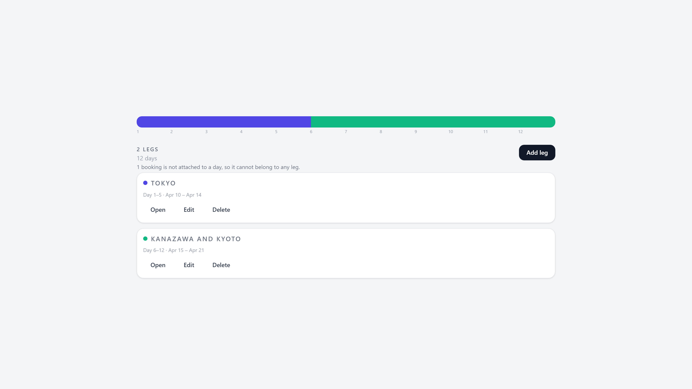

# Trip Segments

## What it does

A long trip is one flat list of days in TREK. That works well for a long weekend and badly for six
months across Japan and Thailand, where day 78 tells you nothing about where you actually are. Trip
Segments lets you draw legs over that list — Tokyo, Kanazawa, Bangkok — give each one a colour, and
then read the trip through them.

Each leg is a range of days with a name and a colour. Legs may not overlap, but they may leave gaps,
and the plugin shows you which days are not yet part of any leg so nothing quietly falls through. A
leg is anchored to positions in the day list rather than to calendar dates, so it keeps working on a
trip whose dates are still undecided. When you insert or delete days later, legs are re-resolved on
read: one that now runs past the end of the trip is shown as shortened, and one that has fallen off
the end entirely is greyed out and contributes nothing until you fix it.

The plugin adds a Segments tab to the trip planner, placed directly after Plan. From there you can
create, edit and delete legs, see the whole trip as a single colour bar, and open any leg to get the
part of the trip that belongs to it: the days and their planned places, the bookings that fall inside
the range, and the accommodation stays that overlap it. A booking that crosses a boundary, like the
train that takes you from one leg to the next, deliberately appears in both legs. Bookings that are
not attached to a day at all are listed separately instead of being silently dropped.

Legs also show up outside the tab. The day plan gets a small banner where a leg begins and ends, the
trip map gets one coloured line per leg following its stops in visiting order, the PDF export gets a
summary section listing every leg with its dates and counts, and the trip card on your dashboard gets
a badge with the leg count and the first few names.

Colours are limited to four on purpose. TREK's map, day plan and card surfaces accept a fixed set of
four tones rather than arbitrary colours, so the palette is exactly those four. A leg therefore looks
identical everywhere it appears, instead of being one colour in the tab and a different one on the map.

## Screenshots

## Permissions

| Permission | Why it is needed |
| --- | --- |
| `db:own` | Stores the legs themselves — name, colour, day range — in the plugin's own SQLite database. Nothing is written to TREK's tables. |
| `db:read:trips` | Reads the trip's days, bookings and accommodation stays in order to resolve day ranges and build the per-leg view. Read-only. |
| `ws:broadcast:trip` | Notifies other people looking at the same trip that the legs changed, so their tab refreshes without a reload. |
| `hook:day-schedule-provider` | Draws the "leg begins" and "leg ends" banners inside the day plan. |
| `hook:map-layer-provider` | Draws one coloured line per leg on the trip map. |
| `hook:pdf-section-provider` | Adds the leg summary section to the trip's PDF export. |
| `hook:trip-card-provider` | Adds the leg-count badge to the trip card on the dashboard. |

No personal data is stored. The plugin's database holds only trip ids, leg names, colours and day
numbers, so there is no user data to export or erase.

## Setup

Install the plugin from the registry or sideload the packed zip, then activate it in Admin →
Plugins and approve the permissions listed above. There is nothing else to configure — no API keys,
no settings, no external services are contacted.

Open any trip and you will find a Segments tab immediately after Plan. Use Add leg to draw your
first one: give it a name, pick a colour, and choose the first and last day from the dropdowns. Keep
adding legs until the colour bar across the top covers the parts of the trip you care about. Deleting
a leg only deletes the leg; the days, bookings and stays inside it are untouched, because the plugin
never writes to TREK's own data.

If a leg turns grey with a warning after you edit the trip, days were removed and that leg now points
past the end of the trip. Edit its range to bring it back.
